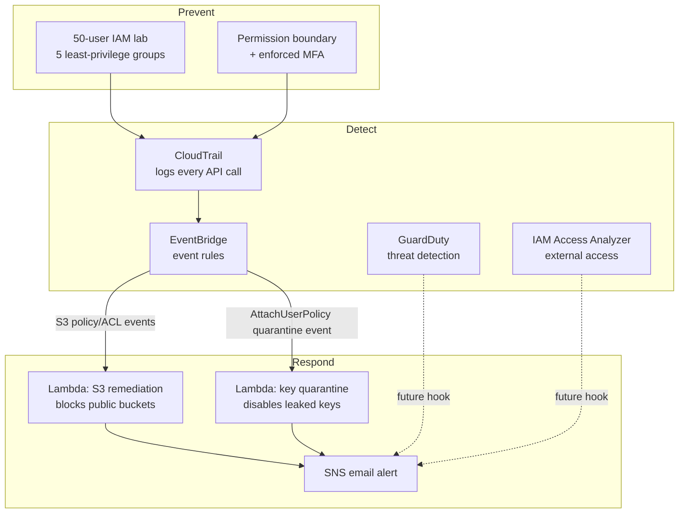

# Guardrail — AWS Security Auto-Remediation Platform

Guardrail is an event-driven security platform on AWS that **detects misconfigurations and compromised credentials, then automatically fixes them within minutes** — no human has to notice first. Every resource is defined as code with Terraform, and every remediation Lambda is covered by an automated test suite.

Built as a hands-on project to learn cloud security engineering the way it's actually practiced: prevent, detect, respond, and prove it with tests and infrastructure as code.

## What it does

| Trigger | Detection | Response |
|---|---|---|
| A bucket is made public (policy, ACL, or Block Public Access change) | CloudTrail → EventBridge | Lambda re-enables Block Public Access within minutes, unless the bucket is tagged exempt |
| An IAM access key leaks publicly (e.g. pushed to GitHub) | AWS attaches its `AWSCompromisedKeyQuarantine` policy → CloudTrail → EventBridge | Lambda deactivates the leaked key, unless the user is on a protected list |
| Any change across the account | CloudTrail (multi-region, log-file-validated, KMS-encrypted) | Full audit trail, retained in a hardened S3 bucket |
| Unusual or malicious activity | Amazon GuardDuty | Finding generated (alerting hook planned see Roadmap) |
| A resource shared outside the account | IAM Access Analyzer | Finding generated |

Every automated fix is **reversible**, **tag-exemptable**, **idempotent**, and ships with a **dry-run mode** so new logic can be watched before it's trusted to act.

## Architecture

## Safety design

Automation that can change a production account is dangerous if it's wrong, so every remediation Lambda follows the same rules:

- **Dry-run by default.** New logic only reports what it *would* do until it's been watched and trusted.
- **Tag-based exemptions.** A resource or user tagged `guardrail-exempt=true` is skipped and logged, not silently fought.
- **Reversible actions only.** S3 fixes block public access (never delete a policy); leaked keys are deactivated (never deleted).
- **Least-privilege roles.** Each Lambda's IAM role can only do the one job it needs, e.g. the key-quarantine function cannot touch S3, and the S3 function cannot touch IAM.
- **A protected-principal hard stop.** The key-quarantine Lambda has an explicit `Deny` in its IAM policy not just application logic preventing it from ever touching the break-glass admin account, even if the code has a bug.
- **Idempotent.** Running twice (or catching its own follow-up CloudTrail event) is always safe and produces no duplicate alerts.

## Repository structure

## Tech stack

**AWS:** IAM, CloudTrail, KMS, S3, EventBridge, Lambda, SNS, GuardDuty, IAM Access Analyzer
**Infrastructure as Code:** Terraform
**Automation:** Python (boto3)
**Testing:** pytest, moto (mocked AWS - tests never touch a real account)

## Testing

Each Lambda has its own pytest suite (12 tests apiece) covering the success path, dry-run mode, tag exemptions, idempotency, and protected principals, all run against `moto`'s mocked AWS nothing in `tests/` ever calls real AWS. A separate parametrized suite validates the IAM lab's least-privilege and MFA-enforcement logic directly against policy simulation.

## Cost

Built and tested entirely within AWS free-tier limits and a small amount of promotional credit. Typical cost to run the full detect-and-respond pipeline for a few days of active testing: **under $5**, mostly covered by AWS credits. Nothing in this repo requires an always-on server.

## Status / Roadmap

- [x] Hardened, encrypted, tamper-resistant CloudTrail logging
- [x] 50-user least-privilege IAM lab with permission boundaries + enforced MFA
- [x] GuardDuty + IAM Access Analyzer
- [x] S3 public-bucket auto-remediation (tested live, dry-run and active modes)
- [x] Leaked IAM key auto-quarantine (tested live, dry-run and active modes)
- [ ] CI/CD pipeline (GitHub Actions: Checkov, tflint, pytest, `terraform plan` on PR, OIDC — no long-lived AWS keys in CI)
- [ ] EC2 quarantine response for GuardDuty findings
- [ ] Wire GuardDuty/Access Analyzer findings into the same alert pipeline

## Author

Yash Barot — [GitHub](https://github.com/yashbarot2096) · [LinkedIn](https://www.linkedin.com/in/yash-barot-7ba306237/)
